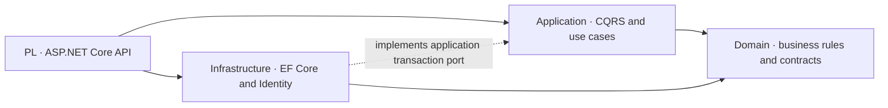

# Hospital Management System

An ASP.NET Core Web API for managing hospital departments, doctors, appointments, medicines, nursing workflows, staff shifts, and patient assignments. The solution is organized into Domain, Application, Infrastructure, and API layers and uses SQL Server, ASP.NET Core Identity, JWT bearer authentication, MediatR, FluentValidation, and Entity Framework Core.

> **Project status:** Active development. Core staff and operational workflows are implemented. Patient-facing clinical workflows and several identity, authorization, and concurrency requirements remain in progress. This README describes the current codebase and calls out the known gaps below.

## What the system does

- Registers and authenticates user accounts; issues JWT access tokens and supports authenticated password changes.
- Manages doctors, departments, nurses, shifts, and staff-to-patient assignments.
- Creates and updates appointments, including queries by doctor, patient, date range/status, and upcoming/cancelled state.
- Manages medicines, dispensing, stock adjustments, and expiry/low-stock queries.
- Records patient vital signs and persists patient, medical-record, prescription, pharmacy, and dispense entities.

Patient and clinical-record entities are present in persistence, but full patient registration/profile use cases and patient-owned medical-record APIs are not implemented yet.

## Architecture



| Project | Responsibility |
| --- | --- |
| `Domain` | Business entities and aggregates, value objects, domain events, errors, rules, and repository/service contracts. |
| `Application` | MediatR commands and queries, handlers, DTOs, mapping, validation, and application-level transaction contracts. It references `Domain`, not `Infrastructure`. |
| `Infrastructure` | EF Core `ApplicationDbContext`, SQL Server mappings and migrations, repositories, ASP.NET Identity persistence, and the EF transaction implementation. |
| `PL` | ASP.NET Core controllers, JWT authentication, authorization policies, middleware, dependency injection, Swagger, health endpoint, and host configuration. |
| `Domain.Tests` | xUnit tests for domain behavior and selected persistence behavior. |

### Request lifecycle

1. Controllers send MediatR requests to the Application layer.
2. FluentValidation validates requests before their handlers run.
3. Write requests implement `ICommandRequest<T>` and execute inside the transaction behavior. Queries do not open database transactions.
4. Failed domain `Result` responses roll back by default. Login is the exception: rejected logins commit failed-attempt/lockout state. Successful writes commit before domain events are dispatched.
5. Infrastructure implements the application transaction port and persists data through EF Core and SQL Server.

Domain event dispatch is currently best-effort after commit. There is no outbox yet, so reliable delivery across process failures remains future work.

## Modules and current status

| Module | Implemented | Remaining work |
| --- | --- | --- |
| **Authentication** | Registration, username/email login, JWT issuance and validation, authenticated password change, persistent lockout rules, password history, admin-controlled user-role changes and staff-profile linking, and a `staff_id` claim for linked staff. Two-factor-enabled accounts cannot receive a password-only token. | Complete 2FA setup and verification, email confirmation, and password reset/recovery and refresh-token flows. |
| **Doctors** | Doctor lifecycle, profile and office updates, department transfer, schedule/appointment use cases, value objects, and domain events. | Tie doctor profiles to login identities; expand authorization and API/integration coverage. |
| **Departments** | Create/read/update operations, activation/deactivation, case-normalized duplicate checks, a database uniqueness constraint, value objects, and domain events. | Broader application and persistence integration tests. |
| **Appointments** | Create, list and retrieve, query by doctor/patient/upcoming/cancelled, reschedule, update description/participants, and cancel. Booking checks active doctors, working shifts, patient existence, and exact timestamp conflicts. A filtered unique index blocks duplicate active doctor/time slots. | Define appointment duration and overlap semantics; add broader API/integration and concurrent-booking tests. |
| **Medicines and dispensing** | Medicine management, stock adjustments, dispensing, expiry and low-stock queries, rowversion optimistic concurrency for stock changes, and conflict responses for concurrent writes. | SQL Server integration tests and broader dispensing coverage. |
| **Nursing, staff, and shifts** | Nurse management, shifts, patient assignments/transfers, vital-sign recording, department changes, head-nurse status, and admin-controlled account-to-staff linking with a consistent `staff_id` claim. | Broaden authorization and persistence tests. |
| **Patients and clinical records** | Patient self-service profile creation and update through `/api/patients/me`, backed by an optional unique account link; clinical-record entities and nurse assignment support. | Patient medical-record and prescription APIs, ownership rules for clinical data, and broader API/integration coverage. |

## API reference

The API base path is `/api`. Swagger UI is enabled in the Development environment. Routes use lowercase prefixes.

### Authentication — `/api/auth`

| Method | Route | Access | Purpose |
| --- | --- | --- | --- |
| `POST` | `/api/auth/register` | Anonymous | Register a patient-role account and return a token. |
| `POST` | `/api/auth/login` | Anonymous | Sign in with username or email and password. |
| `POST` | `/api/auth/change-password` | Authenticated | Change the current user's password. |

### Patient profile — `/api/patients/me`

| Method | Route | Access | Purpose |
| --- | --- | --- | --- |
| `GET` | `/api/patients/me` | Patient | Read the signed-in patient's own profile. |
| `PUT` | `/api/patients/me` | Patient | Create or update the signed-in patient's own profile. |

### Administrative user linking — `/api/admin/users`

| Method | Route | Purpose |
| --- | --- | --- |
| `PATCH` | `/api/admin/users/{userId}/role` | Assign a non-admin application role. |
| `PUT` | `/api/admin/users/{userId}/staff/{staffId}` | Link a doctor or nurse account to its staff record. |

Authentication controller requests are limited to 10 requests per minute per client IP.

### Departments — `/api/departments`

| Method | Route | Purpose |
| --- | --- | --- |
| `POST` | `/api/departments/register` | Create a department. |
| `POST` | `/api/departments` | Create a department (preferred route). |
| `GET` | `/api/departments` | List departments. |
| `GET` | `/api/departments/{id}` | Retrieve a department. |
| `PUT` | `/api/departments/{id}/rename` | Rename a department. |
| `PUT` | `/api/departments/{id}/change-description` | Update its description. |
| `PUT` | `/api/departments/{id}/activate` | Activate a department. |
| `PUT` | `/api/departments/{id}/deactivate` | Deactivate a department. |

### Doctors — `/api/doctors`

`GET /api/doctors?includeInactive={bool}`, `GET /api/doctors/{id}`, `POST /api/doctors/register`, `PATCH /api/doctors/{id}/name`, `PATCH /api/doctors/{id}/contact`, `PATCH /api/doctors/{id}/relocate`, `PATCH /api/doctors/{id}/update-specialization`, `PATCH /api/doctors/{id}/transfer-department`, `POST /api/doctors/{id}/deactivate`, and `POST /api/doctors/{id}/reactivate`.

### Appointments — `/api/appointments`

`GET /api/appointments`, `GET /api/appointments/{id}`, `GET /api/appointments/doctor/{doctorId}`, `GET /api/appointments/patient/{patientId}`, `GET /api/appointments/upcoming`, `GET /api/appointments/cancelled`, `POST /api/appointments`, `PUT /api/appointments/{id}/date`, `PUT /api/appointments/{id}/description`, `PUT /api/appointments/{id}/doctor`, `PUT /api/appointments/{id}/patient`, and `DELETE /api/appointments/{id}`.

### Medicines — `/api/medicines`

`GET /api/medicines`, `GET /api/medicines/{id}`, `GET /api/medicines/{id}/details`, `GET /api/medicines/low-stock`, `GET /api/medicines/expired`, `GET /api/medicines/expiring-next-month`, `POST /api/medicines`, `PUT /api/medicines/{id}`, `DELETE /api/medicines/{id}`, `POST /api/medicines/adjust-stock`, and `POST /api/medicines/dispense`.

### Nurses — `/api/nurses`

`GET /api/nurses`, `GET /api/nurses/{id}`, `GET /api/nurses/{shiftId}/nurses/{nurseId}/patients`, `POST /api/nurses/register`, `PUT /api/nurses/update`, `DELETE /api/nurses/{id}/delete`, `POST /api/nurses/assign`, `POST /api/nurses/transfer-assignment`, `POST /api/nurses/end-assignment`, `POST /api/nurses/record-vital-signs`, `PUT /api/nurses/{nurseId}/department/{departmentId}`, and `PUT /api/nurses/{nurseId}/head-nurse-status`.

### Shifts — `/api/shifts`

`POST /api/shifts`, `PUT /api/shifts/{shiftId}`, `DELETE /api/shifts/{shiftId}/staff/{staffId}`, `GET /api/shifts/{shiftId}`, `GET /api/shifts/staff/{staffId}`, and `GET /api/shifts/available`.

### Health

`GET /health` is anonymous and confirms that the API process responds. It does not check SQL Server connectivity.

## Authorization

JWT bearer authentication is required by default. The current role policies are:

| API area | Allowed roles |
| --- | --- |
| Departments, doctor management, shifts | `Admin` |
| Appointments | `Admin`, `Doctor` |
| Nurse operations | `Admin`, `Doctor`, `Nurse` |
| Medicine reads and dispensing | `Admin`, `Doctor`, `Nurse` |
| Medicine create/update/delete and stock adjustment | `Admin` |
| Patient self-profile | `Patient` |
| User-role and staff-profile linking | `Admin` |
| Register, login, health check | Anonymous |

Role checks are in place, but patient ownership checks are not. Patient clinical-record endpoints should remain unavailable until identity-to-patient links and resource-level authorization are implemented.

## Technology

- .NET 8 across the solution projects
- ASP.NET Core Web API and ASP.NET Core Identity
- Entity Framework Core 9 with SQL Server
- JWT bearer authentication
- MediatR 11, CQRS, and FluentValidation
- AutoMapper
- xUnit and FluentAssertions
- Docker and Docker Compose for local containerized operation

## Getting started

### Prerequisites

- .NET 8 SDK
- SQL Server 2022 or another compatible SQL Server instance
- EF Core CLI compatible with EF Core 9 (the repository currently uses EF Core 9.0.9)
- Docker Compose (optional)

### Configuration

Set `ConnectionStrings__DefaultConnection` to the SQL Server connection string for your environment. The checked-in connection string is a local development default.

Development reads its JWT signing key from `PL/appsettings.Development.json`. For other environments, provide `JWT__SigningKey` with at least 32 UTF-8 bytes, plus `JWT__Issuer` and `JWT__Audience`. Keep production secrets in an environment-specific secret store and never reuse the development signing key.

### Restore, migrate, build, test, and run

```bash
dotnet restore Hospital-Management-System.sln
dotnet ef database update --project Infrastructure --startup-project PL --context ApplicationDbContext
dotnet build Hospital-Management-System.sln
dotnet test Hospital-Management-System.sln
dotnet run --project PL --launch-profile http
```

The HTTP development profile serves the API at `http://localhost:5277`; Swagger UI is at `http://localhost:5277/swagger`.

The repository includes an `InitialCreate` migration. Before applying it to an existing database, compare the target schema with the migration; it is intended to establish the schema and may conflict with tables created outside EF migrations.

The appointment-slot and department-name migrations add filtered unique indexes. Resolve any existing duplicate active doctor/time slots or active department names before applying these migrations.

### Docker Compose

Set `MSSQL_SA_PASSWORD` and `JWT_SIGNING_KEY` in the environment. The JWT signing key must contain at least 32 bytes. Start the API and SQL Server with:

```bash
docker compose up --build
```

The API listens on port `8080`; SQL Server data persists in the `sqlserver-data` volume. Compose does not apply database migrations automatically. Apply the EF migration before using the API.

## Engineering improvements in `major-fixes`

- Introduced an Application transaction port implemented by Infrastructure, removing Application's direct project dependency on Infrastructure.
- Limited transaction behavior to write commands; queries no longer open transactions. Authentication handlers use the shared boundary instead of creating nested transactions.
- Roll back failed domain `Result` responses by default, preserve login lockout state on rejected logins, and dispatch domain events after commit.
- Added administrative, clinical, and care-provider role policies; added per-client-IP authentication throttling and made failed-login lockout state commit even when login returns an authentication failure.
- Validated appointment doctor, shift, patient, and conflict rules and added a filtered unique doctor/time index with a `409 Conflict` response for race collisions.
- Added case-normalized department duplicate checks, a filtered unique-name index, consistent not-found handling, and soft-deleted record filtering.
- Standardized API route prefixes and corrected the nurse update route.
- Aligned the test project with .NET 8, added CI for restore/build/test and migration-model validation, and added Docker Compose support.
- Added JSON console logging and an anonymous process health endpoint.
- Rewrote this README to describe the actual API, architecture, setup, and remaining work.

## Tests and CI

The existing xUnit suite contains 153 tests. It covers doctor lifecycle, schedules and appointments, department lifecycle and events, patient profile rules, nurses and shifts, patient assignments, authentication domain rules and value objects, transaction behavior for login lockout persistence, and persistence configuration for encrypted two-factor secrets and concurrency/link constraints.

The CI workflow restores, builds, runs the existing tests, and checks for pending EF model changes on pull requests and pushes to `main` or `master`. Application handler, authorization/HTTP contract, concurrency, and SQL Server integration test coverage remains incomplete.

## Development roadmap and known gaps

### Identity and security

- Link Identity/domain users to patient records at account creation; ensure profile workflows require confirmed accounts when email confirmation is implemented.
- Complete two-factor enrollment and verification, email confirmation, password reset/recovery, and refresh-token flows.
- Add security-focused API tests for login, registration, throttling, and account lockout.
- Extend patient-data authorization with resource ownership checks once patient identity links exist.

### Workflows and concurrency

- Add patient registration/profile use cases and API endpoints with medical-record and prescription permissions.
- Define appointment duration and overlap semantics beyond exact timestamp matches; expand concurrent-booking and SQL Server integration coverage.
- Protect medicine stock changes from concurrent writes; expand medicine/dispensing tests.
- Add Application handler tests and API/infrastructure integration tests using a test database.

### Architecture and API consistency

- Standardize aggregates, value objects, domain events, errors, and validation across medicine, nurse, staff, shift, patient, and assignment workflows.
- Consider an outbox for dependable post-commit event delivery.
- Standardize error responses and DTOs; add pagination and API versioning.

### Deployment and operations

- Review package compatibility and update vulnerable/outdated dependencies.
- Add database migration and backup procedures for deployed environments; test recovery of both database data and the Data Protection key ring.
- Add database readiness health checks and code-quality CI checks.
- Define billing, notifications, and audit requirements before implementing those workflows.
